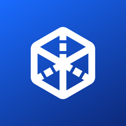
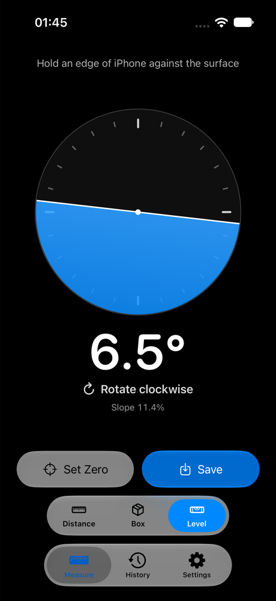
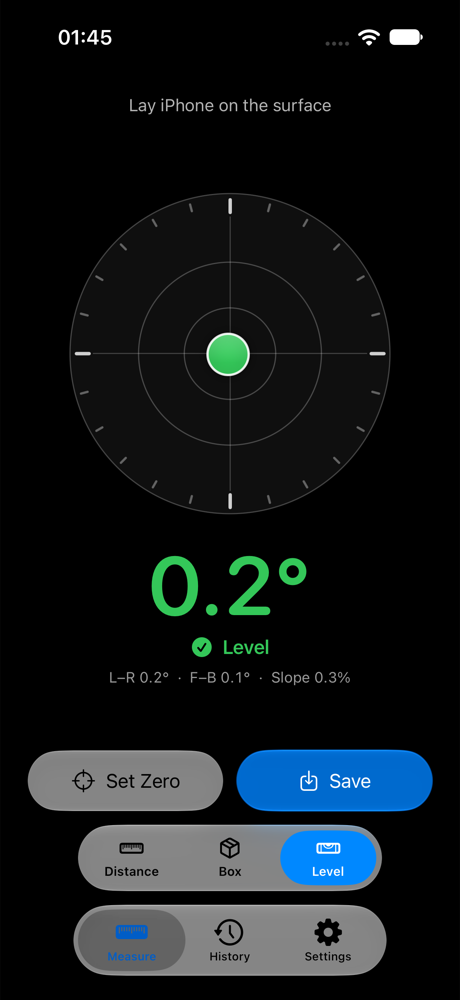
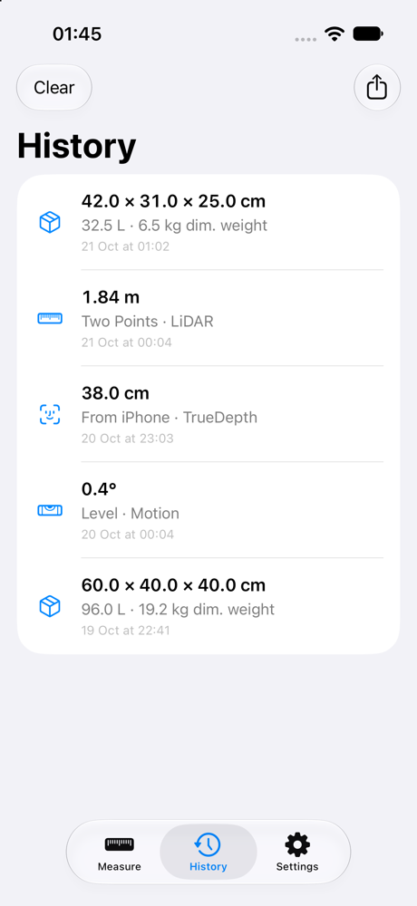
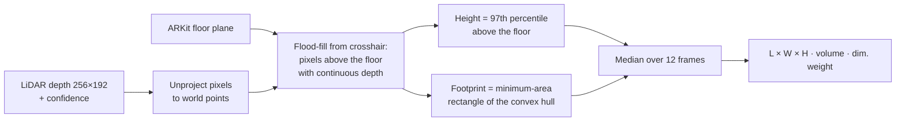

<div align="center">



# DepthKit

**Measure the world with every depth sensor on your iPhone.**<br/>
LiDAR, TrueDepth and the back cameras, in one native SwiftUI app with Siri, widgets and a built-in sensor lab.


<br/>

&nbsp;&nbsp;
&nbsp;&nbsp;


</div>

---

## ✨ Highlights

- 📦 **Box dimensioning.** Aim at a parcel to get length × width × height, volume and courier dimensional weight. This is the logistics feature at the heart of the app.
- 📏 **One Distance tool, every sensor.** Measure between two points, or from the iPhone to a target with the back **LiDAR** or the front **TrueDepth** camera. Flip between them like in Camera.
- 🔬 **Compare sensors in one tap.** See how far Apple's two-camera (stereo) depth is from LiDAR, by day or in the dark, with both depth maps side by side.
- 🫧 **A level that tells you what to do.** An artificial horizon or bubble gauge, a "rotate clockwise" style hint, slope in %, and Set Zero for relative angles.
- 🗣️ **Siri, widgets and Control Center.** Say *"Measure a box with DepthKit"*, see your latest results on the Home and Lock Screen, and launch a tool from Control Center.
- 🛠️ **Developer mode.** Tune the algorithms on device, overlay a live depth heatmap, and capture RGB + LiDAR samples to train depth models.

## 🧭 Tools

| Tool | Sensor | What you get |
|---|---|---|
| **Distance · Two Points** | LiDAR | Distance between any two surfaces |
| **Distance · From iPhone** | LiDAR (back) / TrueDepth (front) | Distance to whatever is under the crosshair, with a confidence badge |
| **Distance · Compare** | LiDAR + two cameras | Stereo vs LiDAR at the center and across the image, plus a plain-language verdict |
| **Box** | LiDAR | L × W × H, liters, dimensional weight (÷5000 / ÷6000) and a 3D wireframe over the camera |
| **Level** | Motion | Edge or surface level, directional hint, slope %, Set Zero |

Every result can be saved to **History**, exported as **CSV**, and appears in the **widget**.

## 📦 How box measuring works

The estimator in [`BoxEstimator.swift`](DepthKit/Core/BoxEstimator.swift) is pure Swift and unit-tested on synthetic depth maps, so it runs without a device.



The rotating-calipers rectangle finds the right length and width whatever the box's angle on the floor. Thresholds such as minimum height, edge depth jump and the percentile can be tuned live in **Settings › Developer**.

## 🗣️ Siri, widgets and Control Center

| Surface | What it does |
|---|---|
| **Siri** | *"Measure a box with DepthKit"*, *"Measure distance with DepthKit"*, *"Open the level in DepthKit"*, *"What was my last measurement in DepthKit"* (answered without opening the app) |
| **Home Screen widget** | Latest result (small), or the last three with Box and Distance shortcuts (medium) |
| **Lock Screen widget** | Latest result, in rectangular or inline style |
| **Control Center** | **Measure Box** and **Measure Distance** controls |
| **Deep links** | `depthkit://measure/box`, `depthkit://measure/distance`, `depthkit://history` |

The app, its widgets and its intents share data through an App Group.

## 🔬 Sensor lab

Can the cameras alone measure depth as well as LiDAR, and what happens at night?

- **On the iPhone:** **Distance › Compare** gives an instant answer with one tap.
- **On a Mac:** the [`lab/`](lab/README.md) folder goes further on the same captures. It undistorts with Apple's calibration tables, rectifies the wide and ultra-wide pair, and scores five methods against LiDAR:

| Method | Input | Reference |
|---|---|---|
| Apple stereo | wide + ultra-wide | AVFoundation dual-camera depth |
| SGBM | wide + ultra-wide | OpenCV semi-global matching |
| FoundationStereo | wide + ultra-wide | Wen et al., CVPR 2025 |
| Depth Pro | one image | Bochkovskii et al. (Apple), ICLR 2025 |
| Prompt Depth Anything | image + LiDAR prompt | Lin et al., CVPR 2025 |

## 🏗️ Architecture

```
DepthKit/
├─ App/          entry point, router (tools, deep links), Siri App Shortcuts
├─ Measure/      ARKit (LiDAR), AVFoundation (TrueDepth), Core Motion engines + measuring UI
├─ Core/         geometry, box estimator, depth stats & colormap, sensor comparison (no ARKit dependency)
├─ History/      history list, CSV export
├─ Settings/     units, dimensional weight, Siri tip, developer parameters
└─ Developer/    developer tools, dataset writer, Compare / Lab Capture
DepthKitWidgets/ Home & Lock Screen widgets, Control Center controls
Shared/          models, App Group store, App Intents (compiled into app + widgets)
DepthKitTests/   geometry, box estimator, level, router, store, sensor comparison
lab/             Python package, tests and notebook for the multi-camera experiment
```

## 🚀 Build and run

```bash
brew install xcodegen      # once
xcodegen generate
open DepthKit.xcodeproj
```

Choose your team in **Signing & Capabilities** (or set `DEVELOPMENT_TEAM` in `project.yml`). If you change the bundle ID, update the App Group `group.vn.kanax.depthkit` too.

```bash
xcodebuild -project DepthKit.xcodeproj -scheme DepthKit \
  -destination 'platform=iOS Simulator,name=iPhone 17' test
```

> The Simulator has no LiDAR, TrueDepth or motion sensors, and each tool explains what is missing. Use an iPhone Pro for LiDAR features. To preview the Level screen in the Simulator, launch with `-demoLevelEdge 6.5` or `-demoLevelFlat 0.2 0.1`.

## 🔒 Privacy

- No account, no network, no analytics.
- Camera frames are processed on the device and never uploaded.
- Images are saved only when you choose to: a Developer sample or a Compare capture. They then appear in **Files › DepthKit**.

## ⚠️ Limitations

- Box mode expects a roughly rectangular box resting on a floor or table that ARKit has detected.
- Dark, shiny or transparent surfaces return less LiDAR depth.
- Infrared-blocking window film is designed to absorb the 900–1000 nm band, which includes LiDAR's 940 nm.
- Results are estimates; accuracy figures will be added after field tests. Use a tape measure for anything critical.

## 🗺️ Roadmap

- [ ] Fine-tune a monocular depth model on paired RGB + LiDAR captures and run it on device with Core ML
- [ ] Low-light enhancement (Zero-DCE / Retinexformer) before stereo at night
- [ ] Live Activity for measuring many boxes in a row

---

<div align="center">
Built by <a href="https://github.com/KanaxNguyen">Nguyen Nam Khanh</a> · AI student at FPT University Hanoi
</div>
